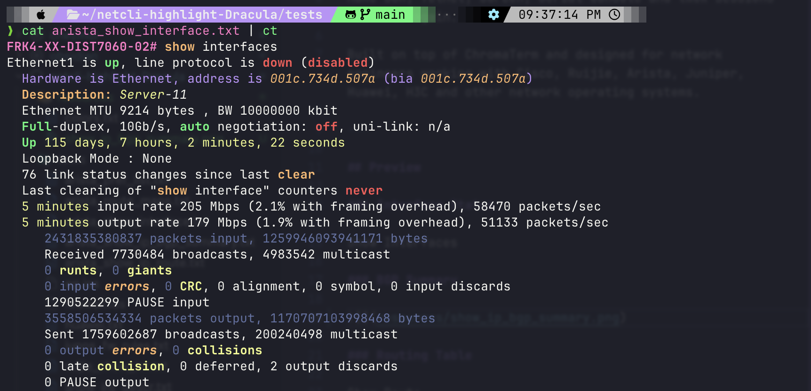
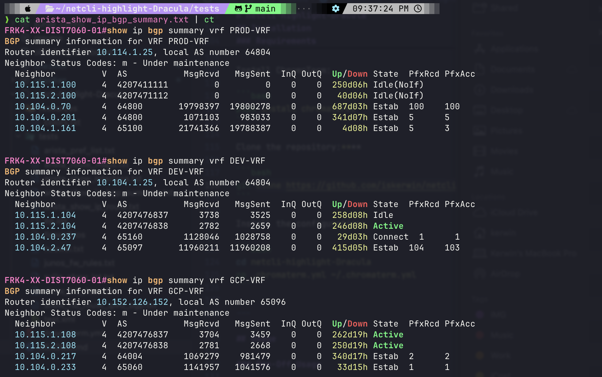
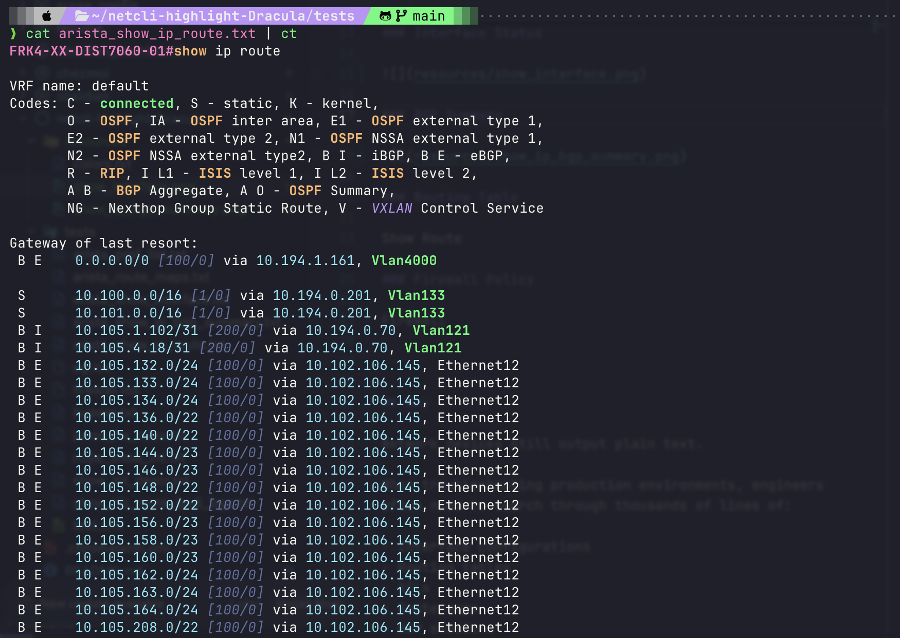

# netcli-highlight-Dracula

> Dracula-inspired syntax highlighting for live network device CLI sessions.

Make SSH, Telnet, Screen, Serial Console and tmux sessions readable again.

Built on top of ChromaTerm and designed for network engineers working with Cisco, Ruijie, Arista, Juniper, Huawei, H3C and other network operating systems.

---

## Preview

### Interface Status



### BGP Summary



### Routing Table




### Firewall Policy

Firewall

---

## Why

Network devices still output plain text.

When troubleshooting production environments, engineers often need to search through thousands of lines of:

- Interface configurations
- Routing tables
- ACLs
- Route-maps
- BGP sessions
- OSPF neighbors
- Firewall policies

Important information is frequently buried inside large amounts of unformatted text.

netcli-highlight-Dracula adds real-time syntax highlighting directly to terminal output, making operational data significantly easier to scan and understand.

---

## Features

- Dracula color palette optimized for dark terminals
- Works with live interactive sessions
- No changes required on network devices
- Vendor-neutral rule set
- Interface state highlighting
- IPv4 / IPv6 / MAC address highlighting
- ACL and Route Policy highlighting
- Routing protocol awareness
- Error and warning detection
- Counter and statistics highlighting
- Fully customizable YAML rules

---

## Supported Platforms

| Vendor                 | Status |
| ---------------------- | ------ |
| Cisco IOS              | ✅      |
| Cisco IOS-XE           | ✅      |
| Cisco NX-OS            | ✅      |
| Arista EOS             | ✅      |
| Juniper JunOS          | ✅      |
| Huawei VRP             | ✅      |
| H3C Comware            | ✅      |
| Ruijie RGOS            | ✅      |
| Linux Networking Tools | ✅      |

---

## Color Philosophy

The default rules are designed around operational visibility instead of strict syntax highlighting.

| Category               | Color      |
| ---------------------- | ---------- |
| Prompt                 | Pink       |
| Interface Names        | Green      |
| IP Addresses           | Cyan       |
| VLANs                  | Yellow     |
| Routing Policies       | Purple     |
| Descriptions           | Orange     |
| Errors & Failures      | Red        |
| Informational Counters | Muted Gray |

The goal is to reduce visual noise while making operationally important information immediately visible.

---

## Installation

### Requirements

- Python 3.11+
- ChromaTerm2

Install ChromaTerm:

```bash 
pipx install chromaterm2
```

Clone the repository:****

```bash 
git clone https://github.com/iskerwin/netcli-highlight-Dracula.git
```

Install the configuration:

```bash
cd netcli-highlight-Dracula
cp .chromaterm.yml ~/.chromaterm.yml 
```

---

## Usage

### One-Off Usage

```bash
ct ssh router01
ct telnet 10.0.0.1
ct screen /dev/ttyUSB0 115200
```

### Recommended Aliases

```bash
alias ssh='ct ssh' 
alias telnet='ct telnet' 
alias screen='ct screen' 
```

After that, your workflow remains unchanged:

```bash
ssh core-switch 
telnet firewall 
screen /dev/ttyUSB0 115200 
```

---

## Test Samples

This repository includes real-world CLI outputs from multiple vendors.

Available examples:

```
tests/
├── arista_pref_list.txt
├── arista_route_maps.txt
├── arista_show_interface.txt
├── arista_show_ip_bgp_summary.txt
├── arista_show_ip_route.txt
├── huawei.txt
├── junos_fw_rules.txt
├── Ruijie_show_int.txt
├── show_int_descr.txt
├── show_rib_route_ipv6_bgp.txt
├── firewall.txt
└── eg.txt
```

Test highlighting locally:

```bash
cat tests/arista_show_interface.txt | ct  
cat tests/Ruijie_show_int.txt | ct  
cat tests/huawei.txt | ct 
```

---

## Configuration

ChromaTerm looks for configuration files in the following locations:

```Plain text 
$HOME/.chromaterm.yml  
$XDG_CONFIG_HOME/chromaterm/chromaterm.yml  
/etc/chromaterm/chromaterm.yml 
```
Rules are defined using YAML:

```yaml
rules:
  - description: Interface
    regex: '(?i)GigabitEthernet'
    color: f#50FA7B bold
```
---

## Performance

ChromaTerm supports both:

- Python re
- PCRE2

For large routing tables and interface outputs, PCRE2 can provide significantly better performance.

See:

https://github.com/hSaria/ChromaTerm

for installation instructions.

---

## Roadmap

- [ ] Better IPv6 highlighting
- [ ] EVPN / VXLAN awareness
- [ ] MPLS L3VPN enhancements
- [ ] Additional vendor-specific rule packs
- [ ] Light color theme
- [ ] Dark+ theme variant
- [ ] Community-contributed rules

---

## Acknowledgements

Inspired by:

- Daniel Macuare's netcli-highlight
- hSaria's ChromaTerm

Special thanks to the network engineering community for sharing regex patterns, CLI outputs, and operational workflows.

---

## License

MIT